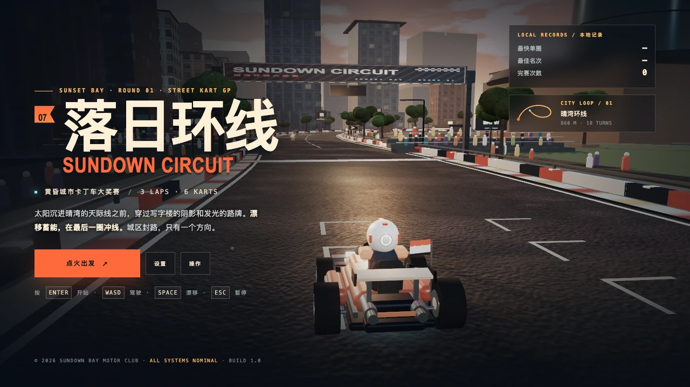
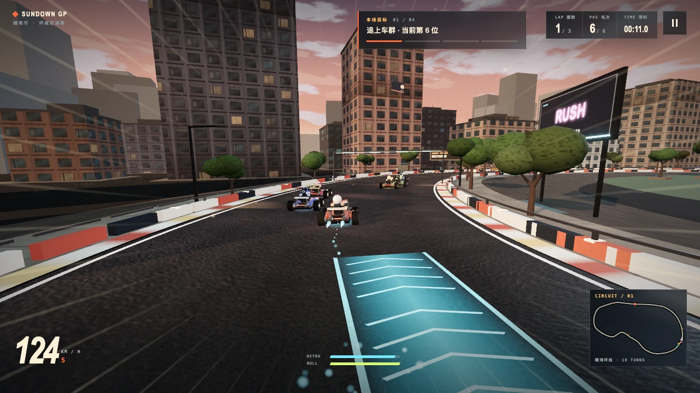
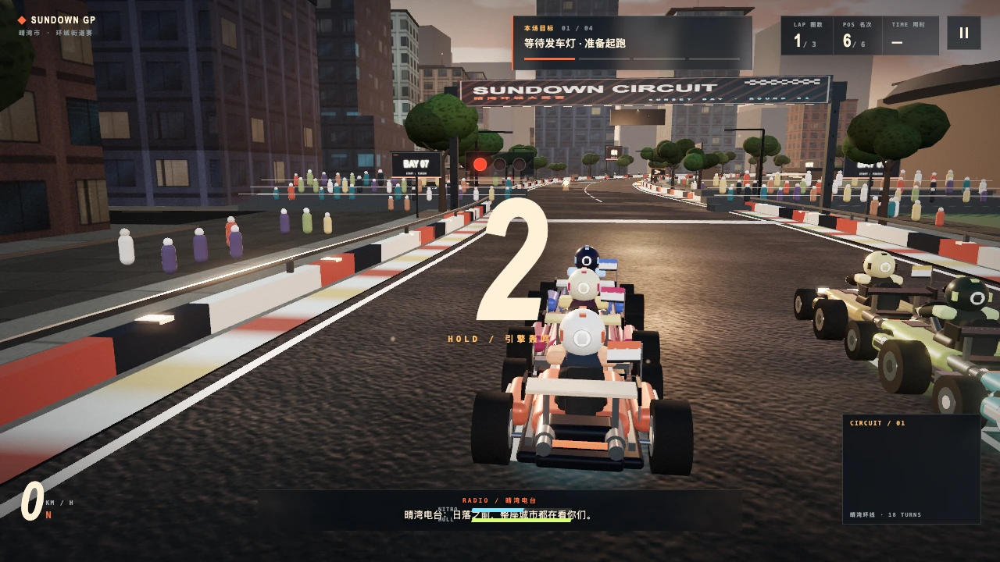
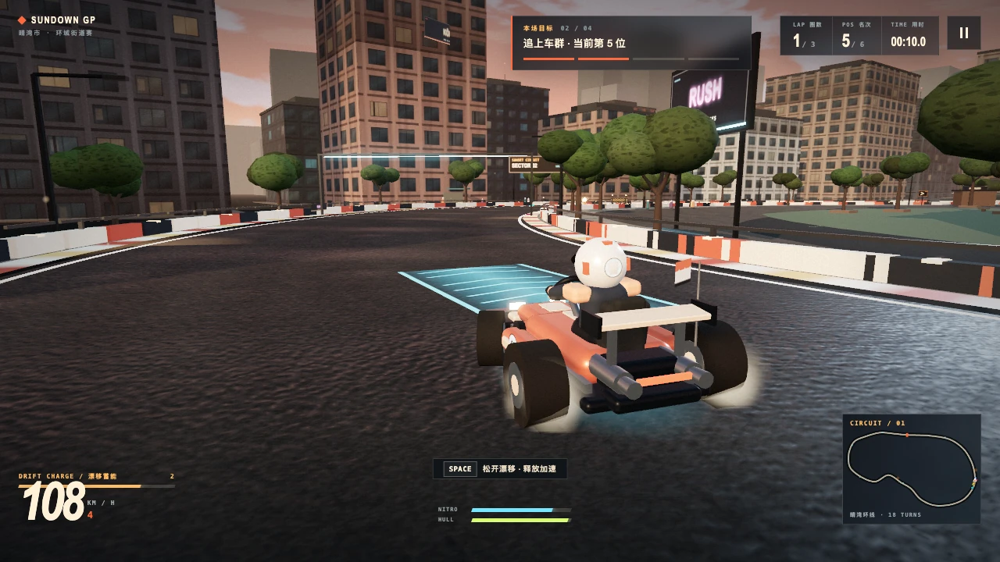
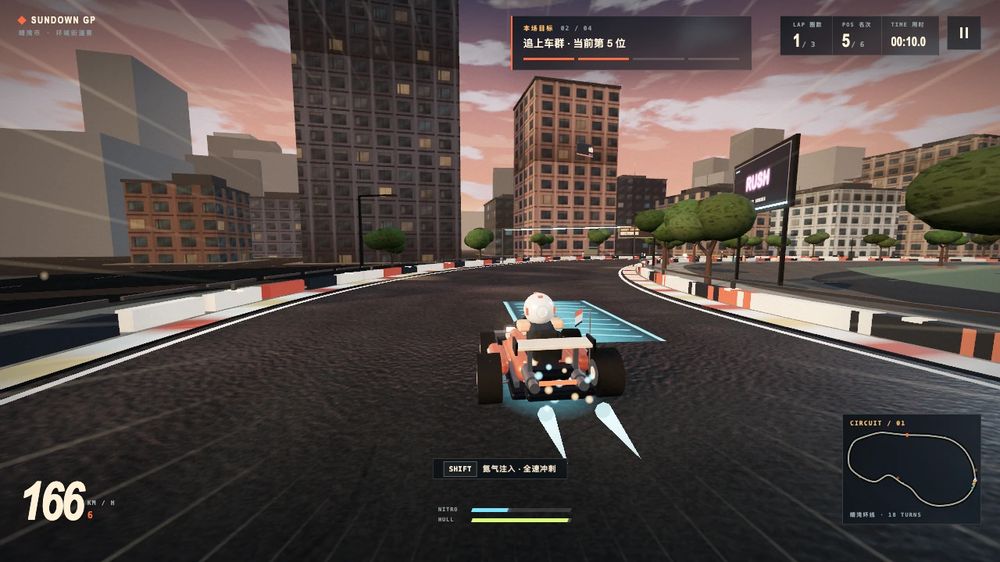
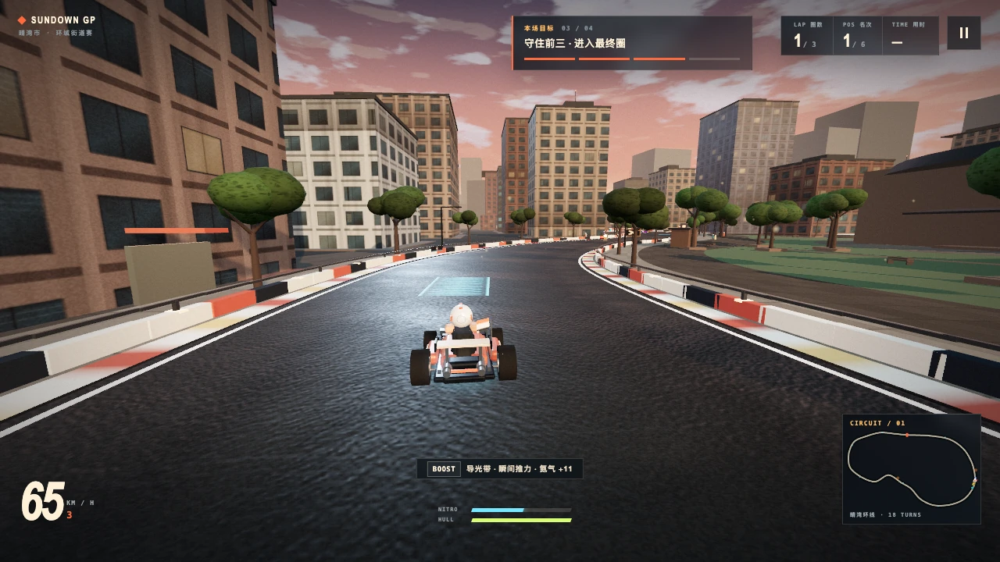
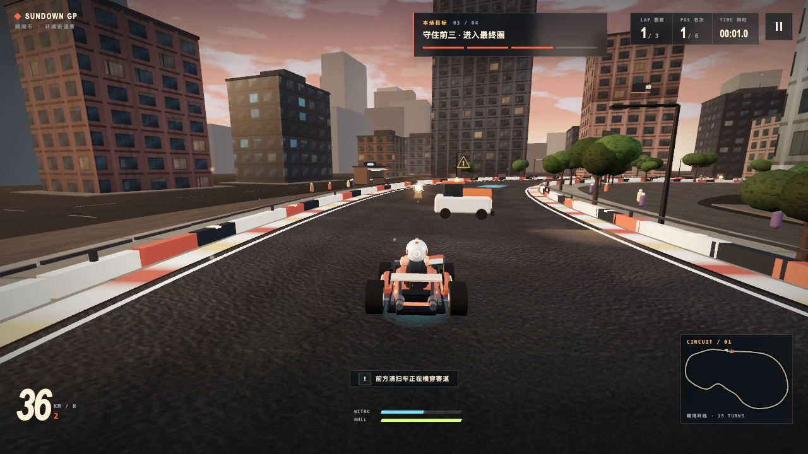
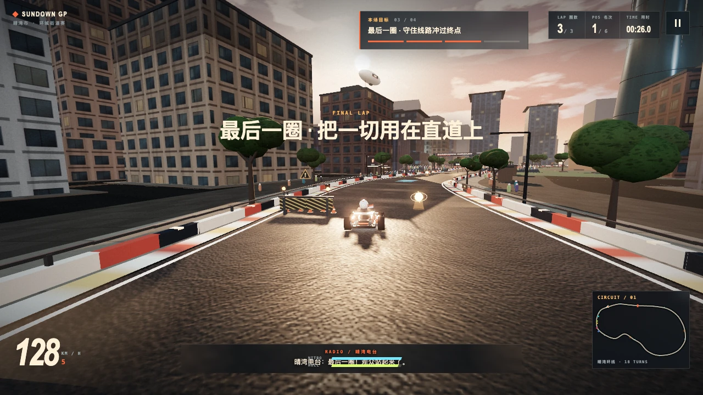
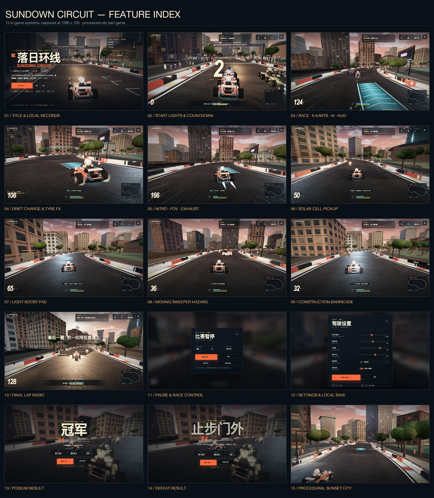
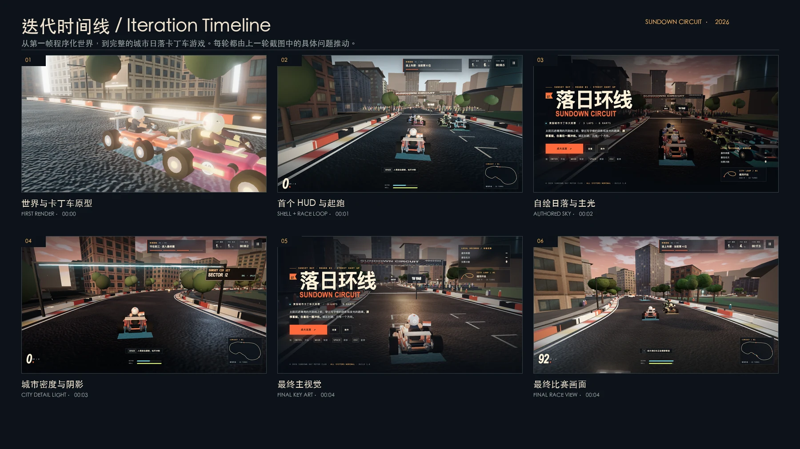

<div align="center">

# 落日环线 · SUNDOWN CIRCUIT

### 一座由代码生长的黄昏城市，一场三圈的街头卡丁车赛。

`3D WEBGL` · `3 LAPS` · `6 KARTS` · `860 M` · `18 TURNS` · `ONE OFFLINE HTML`

**完全独立制作 · 无外部美术 / 模型 / 贴图 / 字体 / 录音素材**

</div>



<p align="center"><sub>TITLE · SUNDOWN BAY · HERO KART 07</sub></p>

---

## 关于这场比赛

太阳落向晴湾市的天际线，城市封路，只剩一个方向。

你驾驶一台 07 号卡丁车，从发车区最后一位起步，穿过写字楼峡谷、中央公园边缘、旧城街角与高架弯道，在 **3 圈** 内追过 5 台 AI 对手。漂移蓄能、导光带和氮气是追回名次的工具；清扫车、施工路障与城市护栏则会让你付出车体耐久的代价。

前三名登上领奖台。第四名，什么也留不下。



<p align="center"><sub>RACE · SIX KARTS · AI OPPONENTS · FULL RACE HUD</sub></p>

---

## 游戏内容

| 系统 | 说明 |
|---|---|
| **晴湾环线** | 860 米闭环城市赛道，18 个弯，3 圈决胜 |
| **6 台卡丁车** | 玩家 + 5 台有独立涂装、头盔与能力差异的 AI 对手 |
| **漂移蓄能** | 入弯按住漂移，1–3 段蓄能，松开释放不同强度的爆发 |
| **氮气冲刺** | 消耗氮气槽，配合 FOV 拉伸、尾焰和速度线 |
| **动态危险物** | 两辆清扫车周期性横穿赛道；施工路障占据赛车线 |
| **赛道补给** | 太阳能电池补充氮气与修复车体；青色导光带提供瞬时推力 |
| **车体耐久** | 撞击会扣耐久，归零则 DNF 退赛 |
| **完整赛事流程** | 标题 → 发车灯/倒计时 → 3 圈 → 胜利/失败/退赛 → 重开 |
| **目标链** | 熄灯起跑、追上车群、进入前三、最终圈冲线 |
| **HUD** | 圈数、名次、计时、速度、耐久、氮气、漂移能量、小地图、提示、字幕 |
| **本地记录** | 最佳圈速、最佳名次、完赛次数、全部设置自动保存 |
| **输入** | 键盘 + 鼠标环视 + 手机五键触控 |
| **声音** | Web Audio 合成引擎、风噪、胎噪、碰撞、提示音与合成器音乐 |

---

## 游戏截图

<div align="center">

<table>
  <tr>
    <td width="50%">
      
      <br><sub><b>发车灯与倒计时</b><br>发车灯、倒计时数字与电台提示；按住油门在绿灯获得完美起步。</sub>
    </td>
    <td width="50%">
      
      <br><sub><b>漂移蓄能</b><br>按住漂移积攒 1–3 段能量，松开获得逐级增强的冲刺。</sub>
    </td>
  </tr>
  <tr>
    <td width="50%">
      
      <br><sub><b>氮气冲刺</b><br>氮气消耗、FOV 拉伸、蓝白尾焰与速度线共同构成加速反馈。</sub>
    </td>
    <td width="50%">
      
      <br><sub><b>赛道补给</b><br>太阳能电池修复车体；青色导光带提供瞬时推力并补充氮气。</sub>
    </td>
  </tr>
  <tr>
    <td width="50%">
      
      <br><sub><b>清扫车危险</b><br>警示灯、世界空间感叹号和电台/HUD 语音会同时提醒你避让。</sub>
    </td>
    <td width="50%">
      
      <br><sub><b>最后一圈</b><br>目标链、圈数、中央提示和电台字幕一起进入最后决胜。</sub>
    </td>
  </tr>
</table>

</div>

<details>
<summary><b>查看全部 15 个运行时系统的截图总览</b>（点击展开；图片较大）</summary>
<br>

</details>

更多单张原图、暂停、设置、胜利、失败和 390 × 844 移动端截图，请查看仓库中的 [`features.html`](features.html) 页面。

---

## 操作

| 输入 | 动作 |
|---|---|
| `W` / `↑` | 油门 |
| `S` / `↓` | 刹车 / 倒车 |
| `A` `D` / `←` `→` | 转向 |
| `Space` | 按住漂移蓄能，松开冲刺 |
| `Shift` | 氮气冲刺 |
| `R` | 脱困并回到赛道 |
| 鼠标拖动 | 环视 / 调整追尾镜头 |
| `Esc` | 暂停 |
| `M` | 静音 |

**触屏**：左侧左右转向；右侧油门、刹车、漂移、氮气。

---

## 技术说明

### 这是一个单文件游戏

最终游戏是一份自包含的 HTML：Three.js、所有着色器、Canvas 生成的城市纹理、UI、粒子和声音都内联在一个文件中。没有 CDN、没有外部请求、没有构建产物之外的依赖。

### 程序化美术

- 自写渐变天空与 3D 云层 shader，太阳光晕 + 暖霾 + PMREM 环境反射。
- 10 个建筑立面变体、城市街区、160 米 Helios 塔、霓虹招牌、店铺、观众、树木、路灯与飞艇。
- 沥青 albedo / roughness / normal、玻璃、混凝土、草地与树叶纹理均由 Canvas 和程序化噪声生成。
- 每台卡丁车都有底盘、悬挂、可转向轮、司机、头盔、护目镜、尾翼、号码牌、排气和动态车身倾斜。
- 阴影、Bloom、ACES 色调映射、自定义颗粒/暗角/轻微色散合成。

### 程序化声音

没有录音素材：引擎由双锯齿波随速度调频；风噪与胎噪来自噪声滤波；碰撞、收集、氮气和发车提示为即时合成；菜单/比赛各有一套 Web Audio 合成器配乐。

### 性能

- 全高画质实测约 **650 draw calls / 47 万三角面 / 7 盏灯**。
- 内置低/中/高画质预设，调整像素比、阴影尺寸和 Bloom。
- 桌面和移动端均已测试；移动端无横向溢出。

---

## 迭代过程

这个项目不是“一次生成”的。每轮都先看上一轮截图，找出一个最具体的问题，再做一类修改，然后重新截图验证。



1. **世界原型**：赛道、城市体块、卡丁车和基础驾驶先跑起来。
2. **主光与构图**：自绘日落天空、阴影、PMREM、Bloom、材质与 HUD 排版。
3. **赛事与城市细节**：AI、清扫车、路障、补给、店铺、观众、截图取景与移动端触控。
4. **修复与验收**：修正空气阻尼导致的速度上限错误，补足失败/DNF/重开流程，完成自动化三圈测试。

完整逐轮记录、更多版本截图与验收数字在 [`iterations.html`](iterations.html)。

---

## 制作方法与 Skill

本项目使用 **`photoreal-game` skill** 的工程方法完成：

- 先交付完整可玩的游戏外壳（菜单、发车、暂停、设置、胜负、重开），而不是先堆画面；
- 固定机位、固定状态的运行截图作为迭代依据；
- 按“产品 → 光 → 材质/城市密度 → 碰撞/试玩 → 移动端/性能”的顺序验收；
- 每次修改后重新截图和重跑测试，避免画面提升掩盖玩法回归。

Skill 是流程与 QA 框架，不是素材包。游戏中的城市、车辆、UI、纹理与声音全部为原创程序化生成；没有使用参考图片、现成游戏画面、外部模型、贴图、字体文件或录音。美术方向是“电影感街机城市”，并非照片复刻，因此没有套用照片参考 profile。

---

## 验收

| 项目 | 结果 |
|---|---|
| 自动巡航三圈 | **84.43 秒完赛，P1** |
| 最快圈 | **25.95 秒** |
| 胜利 / 失败 / DNF 结算 | 通过，失败显示具体原因 |
| 暂停 / 设置 / 重开 / 返回菜单 | 通过，返回菜单会清理比赛状态 |
| 本地记录 | 最佳圈速、名次、完赛次数与设置持久化 |
| 移动端 390 × 844 | 通过，无横向/纵向溢出，五组触控键可用 |
| 离线单文件 | 通过，`file://` 直接打开无控制台错误 |
| 网络请求 | 运行时无外部请求 |

---

## 运行与部署

### 本地打开

直接双击 `index.html`，或用任意静态服务器打开。游戏不需要构建步骤。

### GitHub Pages

1. 打开仓库的 **Settings → Pages**。
2. 在 **Build and deployment** 中选择 **Deploy from a branch**。
3. 分支选择 **main**，目录选择 **/(root)**，保存。
4. 等待站点发布完成，入口为 `index.html`，功能截图为 `features.html`，迭代记录为 `iterations.html`。

> 首次启用 GitHub Pages 必须由仓库管理员在设置中完成；普通的 `git push` 没有创建 Pages site 的管理员权限。

---

## 文件结构

```
.
├── index.html              # 完整游戏（单文件、离线）
├── features.html           # 全部功能截图
├── iterations.html         # 迭代过程与 Skill 说明
├── screenshots/            # WebP 截图（无 EXIF 元数据）
├── README.md
├── THIRD_PARTY_NOTICES.md
└── .nojekyll
```

---

## 隐私与第三方

- 无统计、无追踪、无 Cookie、无第三方运行时请求。
- 不包含账号、电子邮箱、服务器地址或本机路径。
- 设置与最佳成绩只写入浏览器本机 `localStorage`，不会上传。
- README 中的截图来自游戏实际运行，已转为 WebP 并去除元数据。
- 唯一第三方运行时为 **Three.js（MIT）**，许可证见 [`THIRD_PARTY_NOTICES.md`](THIRD_PARTY_NOTICES.md)。

<div align="center">
<br>

**SUNSET BAY MOTOR CLUB** · 虚构赛事品牌 · 2026

*一辆车，一条街，三圈落日。*

</div>
